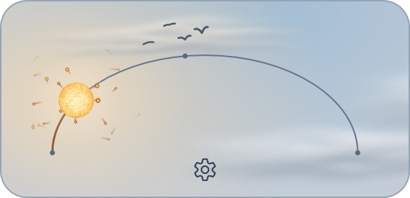
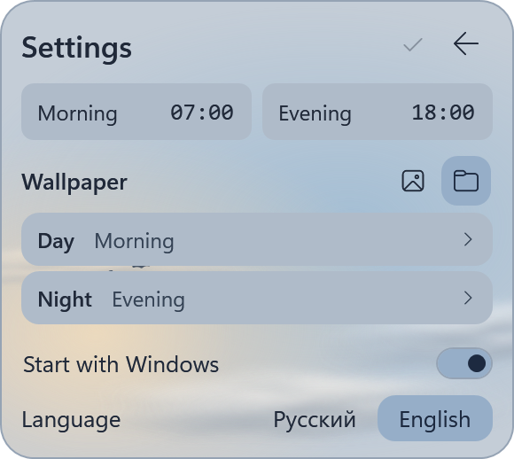

# Heliolune

**Animated day and night wallpaper switching for Windows.**

Heliolune lives in the system tray and changes your desktop wallpaper at the morning and evening times you set. Open the dial to see the current part of the day. Clouds and birds pass behind the sun, and stars and meteors appear after dark.

**English** · [Русский](README.ru.md)

[Download for Windows](https://github.com/CodedSplash/Heliolune/releases/latest) · [Watch the animation](docs/preview.gif) · [Report an issue](https://github.com/CodedSplash/Heliolune/issues/new)

[](https://github.com/CodedSplash/Heliolune/actions/workflows/windows.yml)

| Day dial | Night dial |
| :---: | :---: |
|  |  |

## Quick start

1. Download `Heliolune-Windows.zip` from [GitHub Releases](https://github.com/CodedSplash/Heliolune/releases/latest) and extract it to a folder you can keep.
2. Run `Sutki.exe` and leave `Sutki.exe.config` beside it. The app needs Windows 10 version 1607 or later, or Windows 11, with **.NET Framework 4.8 or later**. Windows 10 version 1903 and later already include .NET Framework 4.8. [Microsoft installation guide](https://learn.microsoft.com/en-us/dotnet/framework/install/on-windows-10)
3. Left-click the tray icon, then click the gear. Set the morning and evening times, choose your wallpapers and click the checkmark. If the tray icon is hidden, look under the arrow near the taskbar clock.

## Settings and controls



- **Morning and evening.** Set the two daily switch times in local time. The defaults are **07:00** and **18:00**. Schedules can cross midnight. In a time field, `↑` and `↓` change the time by 15 minutes. Hold `Shift` to change it by one minute.
- **Wallpaper.** Use one image or one folder for each period. Folder mode picks a random image from the selected folder when the period changes and avoids repeating the last choice when possible. JPG, JPEG, PNG and BMP are supported. The same wallpaper is applied to all monitors.
- **Language and autostart.** Switch between **English** and **Русский** or enable **Start with Windows**. Both changes take effect immediately. Settings are stored locally in `%LOCALAPPDATA%\Sutki\settings.xml`.
- **Tray and panel.** Right-click the tray icon for quick access to the dial, settings or exit. Drag the panel by its background or settings heading. Click outside to dismiss it.

## Build from source

Run these commands in PowerShell from the repository root. Heliolune uses C# and WPF with the .NET Framework compiler on Windows. It has no NuGet dependencies.

```powershell
powershell.exe -NoProfile -ExecutionPolicy Bypass -File .\build.ps1
powershell.exe -NoProfile -ExecutionPolicy Bypass -File .\package.ps1
```

- `build.ps1` writes the executable and config to `bin/`.
- `package.ps1` builds the app and writes a ZIP and SHA-256 checksum to `dist/`.
- [GitHub Actions](https://github.com/CodedSplash/Heliolune/actions/workflows/windows.yml) builds Windows archives for `main` and pull requests. Tags such as `v1.0.0` trigger a release after the build succeeds.

## Author

[CodedSplash](https://github.com/CodedSplash)
