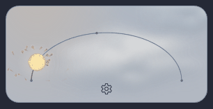
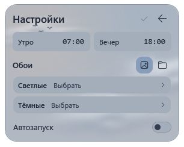

# Heliolune

**«Сутки» — обои по времени суток для Windows 11.** Программа живёт в трее, переключает фон рабочего стола по местному времени и показывает анимированную шкалу с солнцем и луной.

[Скачать для Windows](https://github.com/CodedSplash/Heliolune/releases/latest) · [Сообщить о проблеме](https://github.com/CodedSplash/Heliolune/issues/new)



## Возможности

- Два времени переключения, начало утра и начало вечера. Расписание поддерживает переход через полночь.
- Два изображения или две папки. В режиме папок приложение выбирает случайный файл при смене периода и по возможности избегает повтора.
- Дневная сцена с облаками и птицами, ночное небо со звёздами и метеорами.
- Панель над значком в трее, перетаскивание и опциональный автозапуск при входе в Windows.

## Запуск и настройка

1. Скачайте `Heliolune-Windows.zip` на странице релиза и распакуйте в постоянную папку.
2. Запустите `Sutki.exe`. Файл `Sutki.exe.config` оставьте в той же папке. Требуется Windows 11 с .NET Framework 4.8 или новее.
3. Откройте настройки шестерёнкой, укажите время и источники обоев, затем нажмите галочку. Поддерживаются JPG, JPEG, PNG и BMP. Одно изображение применяется ко всем мониторам.

Левый клик по значку открывает шкалу, правый — меню с настройками и выходом. Автозапуск и язык интерфейса (русский или английский) меняются сразу. Настройки хранятся локально в `%LOCALAPPDATA%\Sutki\settings.xml`.



## Сборка

Исходники C# и WPF находятся в `src/Sutki`. Сборка использует компилятор .NET Framework, доступный на Windows. Дополнительные пакеты NuGet не требуются.

```powershell
powershell.exe -NoProfile -ExecutionPolicy Bypass -File .\build.ps1
```

Результат находится в `bin`. Чтобы собрать ZIP и файл контрольной суммы в `dist`, запустите `package.ps1` тем же способом. GitHub Actions собирает Windows-архив для `main` и pull request. Тег вида `v1.0.0` запускает публикацию релиза после успешной сборки.

## Автор

[CodedSplash](https://github.com/CodedSplash)
