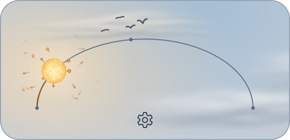
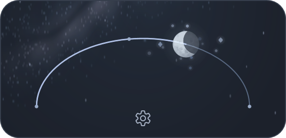
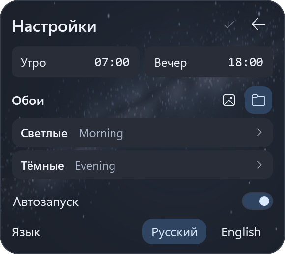

# Heliolune

**«Сутки» — анимированная смена обоев по времени суток для Windows.**

Heliolune работает в трее и меняет обои рабочего стола в заданное время утром и вечером. Откройте шкалу, чтобы увидеть текущую часть суток. Днём за солнцем плывут облака и пролетают птицы, вечером появляются звёзды и метеоры.

[English](README.md) · **Русский**

[Скачать для Windows](https://github.com/CodedSplash/Heliolune/releases/latest) · [Посмотреть анимацию](docs/preview.gif) · [Сообщить о проблеме](https://github.com/CodedSplash/Heliolune/issues/new)

[](https://github.com/CodedSplash/Heliolune/actions/workflows/windows.yml)

| Дневная шкала | Ночная шкала |
| :---: | :---: |
|  |  |

## Быстрый запуск

1. Скачайте `Heliolune-Windows.zip` со страницы [релизов GitHub](https://github.com/CodedSplash/Heliolune/releases/latest) и распакуйте его в постоянную папку.
2. Запустите `Sutki.exe` и оставьте `Sutki.exe.config` рядом. Приложению нужна Windows 10 версии 1607 или новее либо Windows 11 с **.NET Framework 4.8 или новее**. Начиная с Windows 10 версии 1903 .NET Framework 4.8 уже входит в систему. [Инструкция Microsoft по установке](https://learn.microsoft.com/ru-ru/dotnet/framework/install/on-windows-10)
3. Щёлкните левой кнопкой по значку в трее и откройте настройки шестерёнкой. Задайте время утра и вечера, выберите обои и нажмите галочку. Если значок скрыт, ищите его под стрелкой рядом с часами.

## Настройки и управление



- **Утро и вечер.** Укажите два времени переключения по местным часам. По умолчанию это **07:00** и **18:00**. Расписание может пересекать полночь. В поле времени клавиши `↑` и `↓` меняют время на 15 минут, а с `Shift` — на минуту.
- **Обои.** Выберите по одному изображению или папке для каждого периода. При смене периода приложение выбирает случайное изображение из соответствующей папки и по возможности избегает повтора. Поддерживаются JPG, JPEG, PNG и BMP. На всех мониторах устанавливается одно изображение.
- **Язык и автозапуск.** Можно переключаться между **Русский** и **English** и включать запуск при входе в Windows. Оба параметра применяются сразу. Настройки хранятся локально в `%LOCALAPPDATA%\Sutki\settings.xml`.
- **Трей и панель.** Правый щелчок по значку открывает меню со шкалой, настройками и выходом. Панель можно перетащить за фон или заголовок настроек. Щелчок снаружи скрывает панель.

## Сборка из исходников

Выполните команды в PowerShell из корня репозитория. Heliolune написан на C# и WPF и собирается компилятором .NET Framework для Windows. Пакеты NuGet не нужны.

```powershell
powershell.exe -NoProfile -ExecutionPolicy Bypass -File .\build.ps1
powershell.exe -NoProfile -ExecutionPolicy Bypass -File .\package.ps1
```

- `build.ps1` помещает исполняемый файл и конфигурацию в `bin/`.
- `package.ps1` собирает приложение и записывает ZIP и контрольную сумму SHA-256 в `dist/`.
- [GitHub Actions](https://github.com/CodedSplash/Heliolune/actions/workflows/windows.yml) собирает архив для ветки `main` и pull request. Тег вида `v1.0.0` публикует релиз после успешной сборки.

## Автор

[CodedSplash](https://github.com/CodedSplash)
